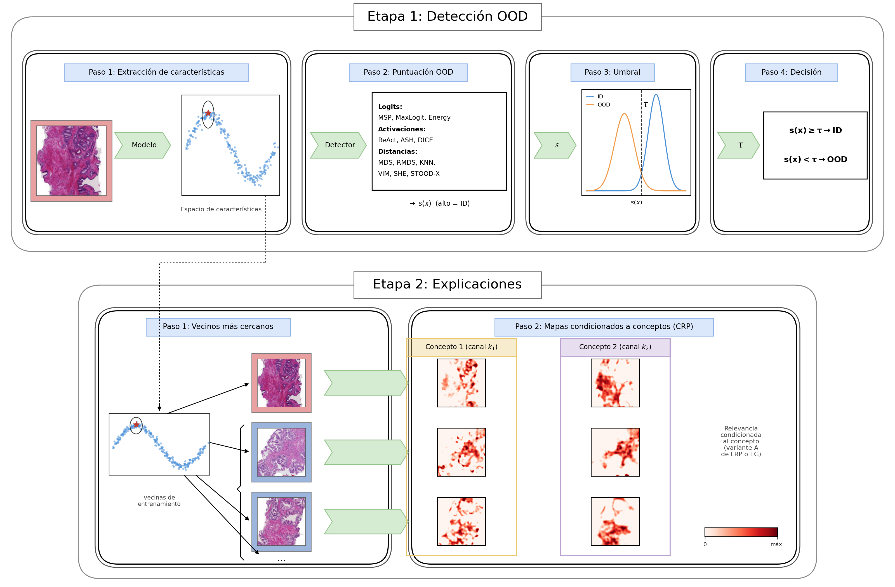

# Inteligencia Artificial Explicable en medicina: métodos para introducir al humano en la adquisición de conocimiento

Código del Trabajo Fin de Grado de **Santiago López Cerro**.

- **Grado:** Doble Grado en Ingeniería Informática y Matemáticas, Universidad de Granada (curso 2026-2027).
- **Tutores:** Francisco Herrera Triguero e Iván Sevillano García.
- **Memoria:** <https://github.com/santiiloce/TFG-memoria>

El trabajo estudia la detección de datos fuera de distribución (OOD) y la explicabilidad de clasificadores de imágenes histopatológicas de próstata.



*Teselas del conjunto PANDA (Bulten et al., 2022; licencia CC BY-NC-SA 4.0), redimensionadas y combinadas en un esquema. Los mapas de relevancia de la etapa 2 son ilustrativos, no salen de CRP. Esta figura se distribuye bajo [CC BY-NC-SA 4.0](https://creativecommons.org/licenses/by-nc-sa/4.0/).*

Esta imagen muestra de modo resumido de qué trata este trabajo. Como se puede observar, dada una muestra tisular de cáncer de próstata, se aplican dos etapas sobre ella:

- **Etapa 1, Detección OOD:**
  - Paso 1: la tesela pasa por el modelo y queda como un punto en el espacio de características.
  - Paso 2: un detector calcula la puntuación s(x). Aparecen los detectores evaluados, agrupados en logits, activaciones y distancias, con STOOD-X como uno más.
  - Paso 3: el umbral τ entre las distribuciones de puntuación ID y OOD.
  - Paso 4: la decisión, s(x) ≥ τ → ID y s(x) < τ → OOD.
- **Etapa 2, Explicaciones:**
  - Paso 1: los vecinos más cercanos de la imagen consulta (marco rojo) en el espacio de características (marcos azules).
  - Paso 2: mapas condicionados a dos conceptos (canales k₁ y k₂), con la variante A de LRP o con EG.

## Contenido

```
.
├── entrenamiento_modelos/   entrenamiento de los cinco clasificadores y su evaluación en el test ID («Materiales y métodos» y «Clasificación ID»)
├── OOD/                     detección OOD: OpenOOD, STOOD-X propio, corrupciones sintéticas y ConvNeXt-S («Detección OOD» y apéndice «Detección OOD con ConvNeXt-S»)
└── XAI/                     LRP y CRP sobre ConvNeXt-S, tratamiento de la LayerNorm, Expected Gradients y atlas RelMax («Explicabilidad y eliminación de sesgos»)
```

Cada carpeta tiene su propio `README.md` con la lista de ficheros, qué hace cada uno, la sección de la memoria donde se usa y qué entradas espera.

## Alcance del repositorio

Solo se publica el código más relevante de los experimentos descritos en la memoria: el entrenamiento de los clasificadores, la detección OOD y la explicabilidad. No se incluyen los conjuntos de datos, los modelos entrenados, los resultados, los scripts que generan las figuras y tablas, los scripts de envío a Slurm ni el código de repositorios de terceros (OpenOOD, STOOD-X, zennit, zennit-crp y el banco de corrupciones de Zhang et al.), salvo las tres clases derivadas que se indican en «Licencia». Por eso, el código no se puede ejecutar tal cual: se publica como registro de lo que se hizo.

Además:

- Conserva las rutas absolutas del clúster donde se ejecutó (`/mnt/homeGPU/...`). Para usarlo en otro equipo hay que cambiar las constantes de ruta de cada script.
- Los scripts se importan entre sí por el nombre del módulo. Las cadenas de dependencias y el `PYTHONPATH` necesario se indican en el README de cada área.

## Entornos

Versiones leídas de los entornos reales (`importlib.metadata`) y de los registros de ejecución:

| Uso | Entorno | Versiones |
|---|---|---|
| Entrenamiento (`entrenamiento_modelos/entrenamiento/`) | `fastai_env`, en el momento del entrenamiento | PyTorch 1.12.1+cu102, torchvision 0.13.1, fastai 2.7.19, fastcore 1.7.29 (según los registros `slurm-*.out` del entrenamiento; el entorno se actualizó después) |
| Evaluación ID y detección OOD (`entrenamiento_modelos/evaluacion/`, `OOD/`) | `fastai_env_ood` | Python 3.9.25, PyTorch 2.8.0, fastai 2.7.19, timm 1.0.25, NumPy 1.26.4, SciPy 1.13.1, scikit-learn 1.6.1, pandas 1.5.3; OpenOOD (commit `3c35632`); Wand 0.6.13 para las corrupciones (instalado aparte) |
| Explicabilidad (`XAI/`) | `crp_env` | Python 3.9.25, PyTorch 2.8.0+cu128, fastai 2.7.19, timm 1.0.25, zennit 0.4.6, zennit-crp 0.6.0, NumPy 1.26.4, SciPy 1.13.1, scikit-learn 1.6.1, pandas 1.5.3 |

## Datos

Los datos **no se distribuyen**. Proceden de:

- **Conjunto ID** (14 clases de tejido de prostatectomía radical): Ayensa-Jiménez et al., «Fine-Grained Prostate Cancer Tissue Classification Through Expert-Annotated Dataset and Clinically Interpretable Deep Learning», IEEE CAI 2026, doi:10.1109/CAI68641.2026.11536250.
- **NCT-CRC-HE-100K-NONORM**: Kather, Halama y Marx (2018), Zenodo, doi:10.5281/zenodo.1214456.
- **PANDA**: Bulten, W., Kartasalo, K., Chen, PH.C. et al. Artificial intelligence for diagnosis and Gleason grading of prostate cancer: the PANDA challenge. *Nat Med* (2022). <https://doi.org/10.1038/s41591-021-01620-2>
- **DTD (Describable Textures Dataset)**: Cimpoi et al., CVPR 2014, doi:10.1109/CVPR.2014.461.

## Cómo citar

Si usas este código, cita el TFG:

> López Cerro, S. (2026). *Inteligencia Artificial Explicable en medicina: métodos para introducir al humano en la adquisición de conocimiento*. Trabajo Fin de Grado, Universidad de Granada. Código: <https://github.com/santiiloce/TFG-OOD-XAI>

```bibtex
@thesis{lopezcerro2026tfg,
  author      = {López Cerro, Santiago},
  title       = {Inteligencia Artificial Explicable en medicina: métodos para introducir al humano en la adquisición de conocimiento},
  type        = {Trabajo Fin de Grado},
  institution = {Universidad de Granada},
  year        = {2026},
  url         = {https://github.com/santiiloce/TFG-OOD-XAI}
}
```

Cita también los trabajos y repositorios de terceros que se indican en el README de cada área.

## Licencia

El código propio se distribuye bajo la **licencia MIT** (fichero [`LICENSE`](LICENSE)), © 2026 Santiago López Cerro.

**Excepción:** tres clases de `XAI/lrp/` derivan de zennit (LGPL-3.0-or-later) y de timm (Apache-2.0): `ConvNeXtBlockCanonizer` y `ZPlusSinSesgo` (en `lrp_convnext_v2.py`) y `TimmBottleneckCanonizer` (en `lrp_fase2.py`). Esas clases se distribuyen bajo **LGPL-3.0-or-later**. Cada una lleva un comentario con su origen y sus cambios, y los textos de las licencias están en [`XAI/lrp/LICENSES/`](XAI/lrp/LICENSES/). El resto de esos dos ficheros es MIT.

**Excepción para la figura:** `img/esquema_tfg.png` contiene teselas del conjunto PANDA, que se publica bajo CC BY-NC-SA 4.0. Por eso la figura se distribuye bajo esa misma licencia ([CC BY-NC-SA 4.0](https://creativecommons.org/licenses/by-nc-sa/4.0/)), no bajo MIT. Si la usas, cita también el artículo de PANDA: Bulten, W., Kartasalo, K., Chen, PH.C. et al. Artificial intelligence for diagnosis and Gleason grading of prostate cancer: the PANDA challenge. *Nat Med* (2022). <https://doi.org/10.1038/s41591-021-01620-2>

Este repositorio no incluye código de OpenOOD, STOOD-X, zennit, zennit-crp ni del banco de corrupciones de Zhang et al. (salvo las tres clases anteriores): solo el código que los importa o los llama.
